# 📝 Prompt Manager

> GenAI 프롬프트를 카테고리별 분류, 키워드 검색, 즐겨찾기 기능으로 효율적으로 관리하는 **Python 콘솔 애플리케이션**입니다.

---

## 🚀 시작하기

### 요구 사항
- **Python**: `3.10` 이상

### 개발 환경 및 Git 사용자 설정

아래는 개발에 사용한 macOS 터미널에서 실제로 실행한 결과입니다. (캡처: 실행 화면 → 개발 환경 확인)

```text
$ python3 --version
Python 3.12.13
$ git --version
git version 2.53.0
$ git config --global init.defaultBranch main
$ git config --get init.defaultBranch
main
$ git config --global user.name "박상혁"
$ git config --global user.email "psh30427@gmail.com"
$ git config user.name
박상혁
$ git config user.email
psh30427@gmail.com
```

| 항목 | 값 |
| :--- | :--- |
| Python 버전 | `3.12.13` |
| Git 버전 | `2.53.0` |
| 기본 브랜치 (`init.defaultBranch`) | `main` |
| `user.name` | `박상혁` |
| `user.email` | `psh30427@gmail.com` |

### 설치 및 실행

```bash
# 1. 저장소 복제
git clone https://github.com/psh30427-ops/prompt-manager.git

# 2. 프로젝트 디렉토리 이동
cd prompt-manager

# 3. 프로그램 실행
python3 prompt_manager_v2.py
```

> 💡 **참고**: 실행 후 콘솔 메뉴에서 원하는 기능의 번호를 입력하여 조작할 수 있습니다. (`0` 입력 시 프로그램 종료)

---

## 📌 주요 기능

| 번호 | 기능 | 설명 |
| :---: | :--- | :--- |
| **1** | **프롬프트 추가** | 제목, 내용, 카테고리를 입력하여 새로운 프롬프트를 등록합니다. |
| **2** | **전체 목록 보기** | 등록된 모든 프롬프트를 번호, 제목, 카테고리와 함께 출력합니다. |
| **3** | **카테고리별 조회** | 특정 카테고리를 선택하여 해당 카테고리의 프롬프트만 모아봅니다. |
| **4** | **프롬프트 검색** | 검색 키워드를 입력하여 제목 및 내용에서 일치하는 프롬프트를 검색합니다. |
| **5** | **상세 보기** | 선택한 프롬프트의 제목, 카테고리, 즐겨찾기 여부 및 전체 내용을 출력합니다. |
| **6** | **즐겨찾기 관리** | 특정 프롬프트의 즐겨찾기 상태를 등록(★)하거나 해제(☆)합니다. |
| **7** | **즐겨찾기 목록** | 즐겨찾기로 등록된 프롬프트 목록만 별도로 출력합니다. |
| **8** | **카테고리 수정** | 프롬프트 하나를 다른 카테고리로 **이동**하거나, 카테고리 **이름을 변경**합니다. |
| **0** | **종료** | 프로그램을 안전하게 종료합니다. |

---

## 🏷️ 카테고리 분류

기본 제공되는 6가지 카테고리 외에도, 신규 등록 시 사용자가 **카테고리를 직접 입력**하여 추가할 수 있습니다.

- ✍️ **텍스트 생성**: 보고서, 문서 작성, 일반 글 작성을 요청하는 프롬프트
- 🖼️ **이미지 생성**: 정지 이미지 및 일러스트 생성을 요청하는 프롬프트
- 🎬 **영상 생성**: 영상 클립 및 비디오 생성을 요청하는 프롬프트
- 👤 **페르소나**: AI에게 특정 역할이나 인격을 부여하는 프롬프트
- ⚡ **자동화**: 업무 자동화 워크플로우 설계 및 스크립트 생성 프롬프트
- 📁 **기타**: 상기 카테고리에 속하지 않는 일반 프롬프트

### ✏️ 카테고리 수정 정책 (메뉴 8번)

메뉴 8번을 선택하면 두 가지 방식 중 하나를 고를 수 있습니다.

| 방식 | 동작 | 처리 규칙 |
| :--- | :--- | :--- |
| **1. 프롬프트 카테고리 이동** | 선택한 프롬프트 **한 개**의 카테고리만 바꿉니다. | 기본 카테고리 6개 중에서 고르거나 직접 입력할 수 있습니다. 현재와 같은 카테고리를 고르면 변경하지 않습니다. |
| **2. 카테고리 이름 변경** | 선택한 카테고리에 속한 **모든 프롬프트**의 카테고리를 한 번에 바꿉니다. | 기본 카테고리 목록(`CATEGORIES`)에 있는 이름이면 목록의 이름도 함께 바뀝니다. 이미 있는 카테고리 이름으로 바꾸면 두 카테고리가 하나로 **합쳐집니다**. 빈 이름은 입력할 수 없고, 같은 이름이면 변경하지 않습니다. |

- 번호를 잘못 입력하면 안내 문구를 출력하고 다시 입력받습니다.
- 다른 데이터와 마찬가지로 변경 내용은 메모리에만 반영되며, 프로그램을 종료하면 기본 데이터로 초기화됩니다.

```text
메뉴 선택: 8

[카테고리 수정]
1. 프롬프트 카테고리 이동
2. 카테고리 이름 변경
번호 선택: 2

[카테고리 이름 변경]
1. 영상 생성
2. 자동화
3. 텍스트 생성
번호 선택: 1
새 카테고리 이름: 영상 제작

'영상 생성' → '영상 제작'(으)로 변경했습니다. (프롬프트 2개)
```

---

## 📦 기본 등록 데이터

프로그램 실행 시 4개의 샘플 프롬프트가 기본 등록되어 있습니다. 모두 실제 과제·작업에서 사용했던 프롬프트입니다.

1. **쿡트너 광고 영상 (15초)** — `영상 생성`
2. **KT 위즈 자동화 과제 - 핵심 프롬프트 모음** — `자동화`
3. **AI의 대학 교육 영향 및 미래 전망 보고서 작성** — `텍스트 생성`
4. **라면 먹방 라이브 방송 영상/이미지 생성** — `영상 생성`

---

## 💾 데이터 저장 방식 (list + dict)

프롬프트 전체는 하나의 `list`(`prompts`)에 담고, 프롬프트 한 개는 `dict`로 표현합니다.

```python
prompts = [
    {
        "id": 1,
        "title": "쿡트너 광고 영상 (15초)",
        "category": "영상 생성",
        "tags": ["광고", "영상", "쿡트너"],
        "favorite": False,
        "content": "...",
    },
    ...
]
```

### 이렇게 관리하는 이유
- **`list`**: 프롬프트가 등록된 순서를 그대로 유지하고, 메뉴에서 보여주는 번호(1, 2, 3 …)로 바로 접근(`prompts[번호 - 1]`)할 수 있습니다. `append()`로 추가도 간단합니다.
- **`dict`**: 제목·카테고리·즐겨찾기·내용처럼 성격이 다른 값을 `p["title"]`, `p["favorite"]`처럼 **이름(key)으로** 꺼낼 수 있어 코드가 읽기 쉽습니다. 나중에 필드(예: 작성일)를 추가하기도 쉽습니다.
- 별도 라이브러리나 DB 설치 없이 Python 기본 자료형만으로 구현할 수 있어 콘솔 과제 범위에 맞습니다.

### 장점
- 구조가 단순하고 직관적이며, 추가 설치가 필요 없습니다.
- 메모리에서 바로 읽고 쓰므로 데이터가 적을 때 빠릅니다.
- `for` 문과 리스트 컴프리헨션으로 카테고리 조회, 검색, 즐겨찾기 필터링을 쉽게 구현할 수 있습니다.

### 단점
- ⚠️ **데이터가 메모리에만 저장됩니다.** 프로그램을 종료하면 새로 추가한 프롬프트와 즐겨찾기 변경 내용이 모두 사라지고, 다시 실행하면 코드에 들어 있는 **기본 데이터 4개로 초기화**됩니다.
- 검색·조회 시 리스트 전체를 처음부터 끝까지 확인하므로 데이터가 많아지면 느려집니다.
- `dict`의 key 이름을 잘못 쓰면(오타) 실행 중에야 `KeyError`로 발견됩니다.
- 영구 저장이 필요하다면 JSON 파일 저장(`json` 모듈)이나 SQLite 같은 DB로 확장해야 합니다.

---

## 📥 저장소 clone 및 실행 예시

```bash
git clone https://github.com/psh30427-ops/prompt-manager.git
cd prompt-manager
ls
python3 prompt_manager_v2.py
```

실행 결과 예시:

```text
$ git clone https://github.com/psh30427-ops/prompt-manager.git
Cloning into 'prompt-manager'...
$ cd prompt-manager
$ ls
README.md  images  prompt_manager_v2.py
$ python3 prompt_manager_v2.py
프롬프트 매니저 프로그램을 시작합니다.

1. 프롬프트 추가
2. 전체 목록 보기
3. 카테고리별 조회
4. 프롬프트 검색
5. 상세 보기
6. 즐겨찾기 관리
7. 즐겨찾기 목록
8. 카테고리 수정
--------------------
0. 종료
메뉴 선택: 2

[전체 프롬프트 목록]
1.    쿡트너 광고 영상 (15초) [영상 생성]
2.    KT 위즈 자동화 과제 - 핵심 프롬프트 모음 [자동화]
3.    AI의 대학 교육 영향 및 미래 전망 보고서 작성 [텍스트 생성]
4.    라면 먹방 라이브 방송 영상/이미지 생성 [영상 생성]
```

---

## 📝 주요 커밋 메시지 예시

기능 하나를 완성할 때마다 `feat:`, `refactor:`, `docs:` 등의 접두어를 붙여 커밋했습니다.

| 커밋 | 메시지 |
| :--- | :--- |
| `8fc4a64` | chore: 프로젝트 초기화 (.gitignore, README 뼈대) |
| `ec56bde` | feat: 기본 프롬프트 데이터 등록 (광고 영상 프롬프트) |
| `aebde84` | refactor: 카테고리 상수 정의 및 기존 데이터 카테고리 정리 |
| `e25f9ae` | feat: 메뉴 구조 및 함수 골격 추가 |
| `eceffec` | feat: add_prompt 기능 구현 |
| `8ce116c` | feat: 전체 목록 보기 기능 구현 |
| `d0c19fd` | feat: 카테고리별 조회 기능 구현 *(feature/category-filter 브랜치)* |
| `81a25b1` | merge: 카테고리별 조회 기능 병합 |
| `2fa763f` | feat: 프롬프트 검색 기능 구현 |
| `03e5b36` | feat: 프롬프트 상세 보기 기능 구현 |
| `469c8e9` | feat: 즐겨찾기 관리 및 목록 기능 구현 |
| `8bf3f25` | docs: README 실행 방법 및 기능 목록 작성 |
| `aa6d41c` | feat: 카테고리 수정 기능 구현 (프롬프트 카테고리 이동, 카테고리 이름 변경) *(feature/category-edit 브랜치)* |
| `711c2b2` | style: 메뉴 목록과 종료 항목 사이에 구분선 추가 |
| `58e0712` | merge: 카테고리 수정 기능 병합 *(충돌 해결)* |

전체 기록은 `git log --oneline --graph`로 확인할 수 있습니다.

---

## 🌿 브랜치 전략과 병합 시점

### 왜 브랜치를 나눴는가
- `main`은 **항상 실행 가능한 상태**로 유지하고, 새 기능은 별도 브랜치에서 개발한 뒤 완성되면 합치기 위해서입니다.
- 기능 개발 중 코드가 깨지더라도 `main`에는 영향이 없고, 문제가 생기면 브랜치만 버리면 됩니다.
- 기능 단위로 작업 범위가 분리되어 커밋 기록을 읽기 쉬워집니다.

### 언제 main에 병합했는가
1. **KT 위즈 자동화 프롬프트 추가 (`2afba4c`)**
   기본 데이터에 KT 위즈 자동화 과제 프롬프트를 별도 브랜치에서 기록·정리(`e4a913b`, `409e4df`)하는 동안 `main`에서도 수정(`36d4f28`)이 있었고, 정리가 끝난 뒤 `main`으로 병합했습니다.
2. **카테고리별 조회 기능 (`81a25b1`)**
   `main`에서 메뉴 골격, 프롬프트 추가, 전체 목록 보기까지 완성한 뒤 `feature/category-filter` 브랜치를 만들어 카테고리별 조회(메뉴 3번)를 구현했습니다. 기능이 정상 동작하는 것을 확인한 후 `git merge --no-ff feature/category-filter`로 `main`에 병합하고 `git push origin main`으로 원격에 반영했습니다. `--no-ff` 옵션으로 병합 커밋을 남겨, 브랜치에서 작업한 기록이 그래프에 드러나도록 했습니다.

```text
*   81a25b1 merge: 카테고리별 조회 기능 병합
|\
| * d0c19fd feat: 카테고리별 조회 기능 구현
|/
* 8ce116c feat: 전체 목록 보기 기능 구현
```

3. **카테고리 수정 기능 (`58e0712`)**
   `feature/category-edit` 브랜치에서 메뉴 8번(카테고리 이동·이름 변경)을 구현(`aa6d41c`)하는 동안, `main`에서도 메뉴 출력 형식을 수정(`711c2b2`)했습니다. 두 브랜치가 `show_menu()`의 같은 위치를 고쳐서 병합할 때 **충돌이 발생**했고, 아래 절차대로 해결한 뒤 병합 커밋을 남겼습니다.

---

## ⚔️ 병합 충돌(merge conflict) 해결 절차

### 일반적인 해결 순서
1. `git merge <브랜치>` 실행 후 `CONFLICT` 메시지가 나오면 병합이 멈춥니다.
2. `git status`로 충돌 파일(`both modified`, `UU`)을 확인합니다.
3. 파일을 열어 `<<<<<<<`, `=======`, `>>>>>>>` 표시 사이의 두 변경 내용을 비교합니다.
   - `<<<<<<< HEAD` ~ `=======`: 현재 브랜치(main)의 내용
   - `=======` ~ `>>>>>>> 브랜치명`: 병합하려는 브랜치의 내용
4. 둘 중 하나를 고르거나 두 내용을 합쳐 올바른 코드로 고치고, 충돌 표시 줄은 모두 지웁니다.
5. 프로그램을 실행해 정상 동작하는지 확인합니다.
6. `git add <파일>`로 해결 완료를 표시하고 `git commit`으로 병합 커밋을 만듭니다.
7. `git push origin main`으로 원격에 반영합니다.
8. 해결이 어려우면 `git merge --abort`로 병합 전 상태로 되돌린 뒤 다시 시도합니다.

### 실제 충돌 사례: 카테고리 수정 기능 병합

**상황**
- `main` (`711c2b2`): 메뉴 7번과 0번 사이에 구분선(`print("-" * 20)`)을 추가
- `feature/category-edit` (`aa6d41c`): 같은 위치에 `print("8. 카테고리 수정")`을 추가

**1) 병합 시도 → 충돌 발생**

```text
$ git checkout main
$ git merge --no-ff feature/category-edit -m "merge: 카테고리 수정 기능 병합"
Auto-merging prompt_manager_v2.py
CONFLICT (content): Merge conflict in prompt_manager_v2.py
Automatic merge failed; fix conflicts and then commit the result.

$ git status --short
UU prompt_manager_v2.py
```

**2) 충돌 내용 확인 (`show_menu()`)**

```text
    print("7. 즐겨찾기 목록")
<<<<<<< HEAD
    print("-" * 20)
=======
    print("8. 카테고리 수정")
>>>>>>> feature/category-edit
    print("0. 종료")
```

**3) 해결: 두 변경을 모두 유지**

8번 메뉴는 기능 목록에 속하고 구분선은 종료 항목을 구분하기 위한 것이므로, `8번 메뉴 → 구분선 → 0. 종료` 순서로 합치고 충돌 표시를 지웠습니다.

```python
    print("7. 즐겨찾기 목록")
    print("8. 카테고리 수정")
    print("-" * 20)
    print("0. 종료")
```

**4) 동작 확인 후 병합 커밋 및 푸시**

```text
$ python3 prompt_manager_v2.py      # 메뉴 8번과 구분선이 함께 출력되는지 확인
$ git add prompt_manager_v2.py
$ git commit                        # 병합 커밋 58e0712 생성
$ git push origin main
```

**결과 그래프**

```text
*   58e0712 merge: 카테고리 수정 기능 병합
|\
| * aa6d41c feat: 카테고리 수정 기능 구현 (프롬프트 카테고리 이동, 카테고리 이름 변경)
* | 711c2b2 style: 메뉴 목록과 종료 항목 사이에 구분선 추가
|/
* 33fb9bc docs: 프로그램 종료 화면 캡처 추가
```

병합 커밋 메시지에도 충돌 파일과 해결 방법을 기록해 두었습니다. (`git show 58e0712`로 확인)

---

## 실행 화면

<details>
<summary>개발 환경 확인</summary>

**Python 버전, Git 버전, 기본 브랜치 설정 및 Hello 출력**

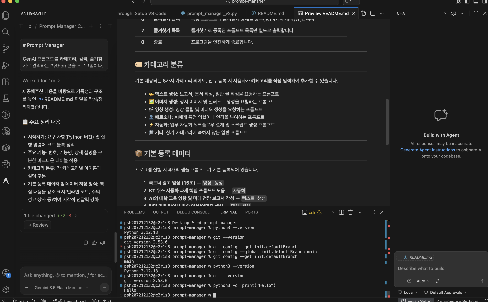

**Git 사용자 정보(user.name, user.email) 설정 및 확인**

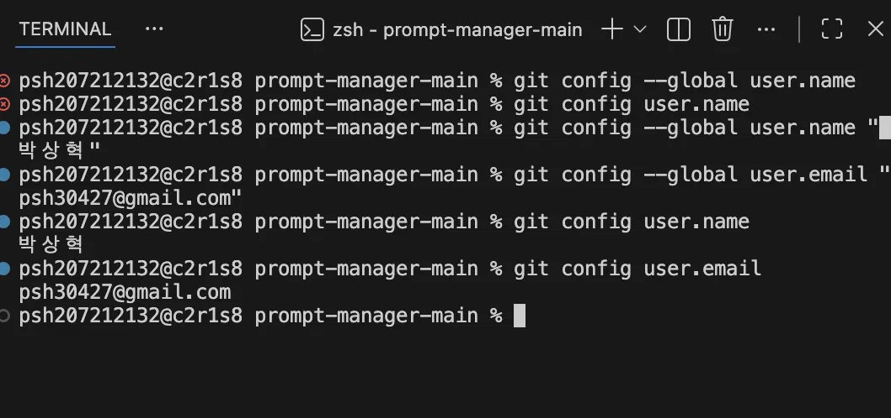

**공개 샘플 저장소 clone 및 폴더 구조·로그 확인**

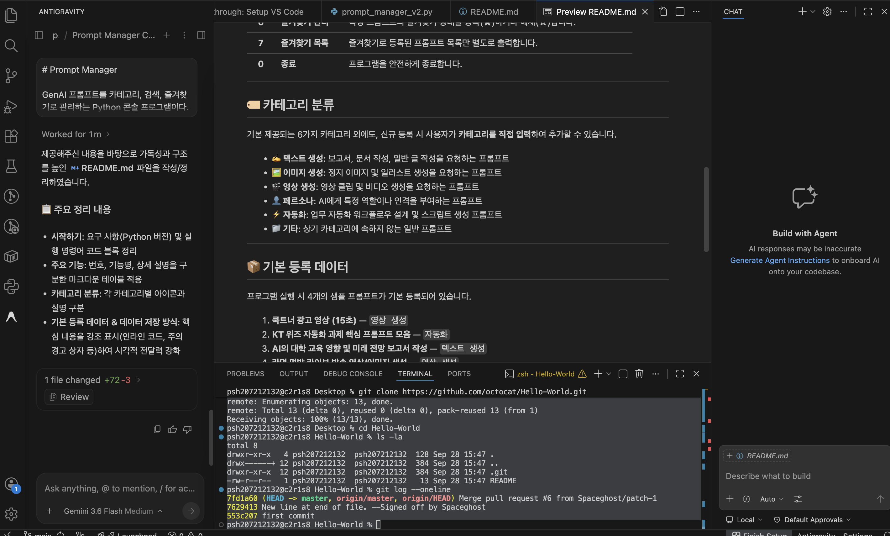

</details>

<details>
<summary>프로그램 실행 화면</summary>

**메뉴 출력 및 기능 선택**

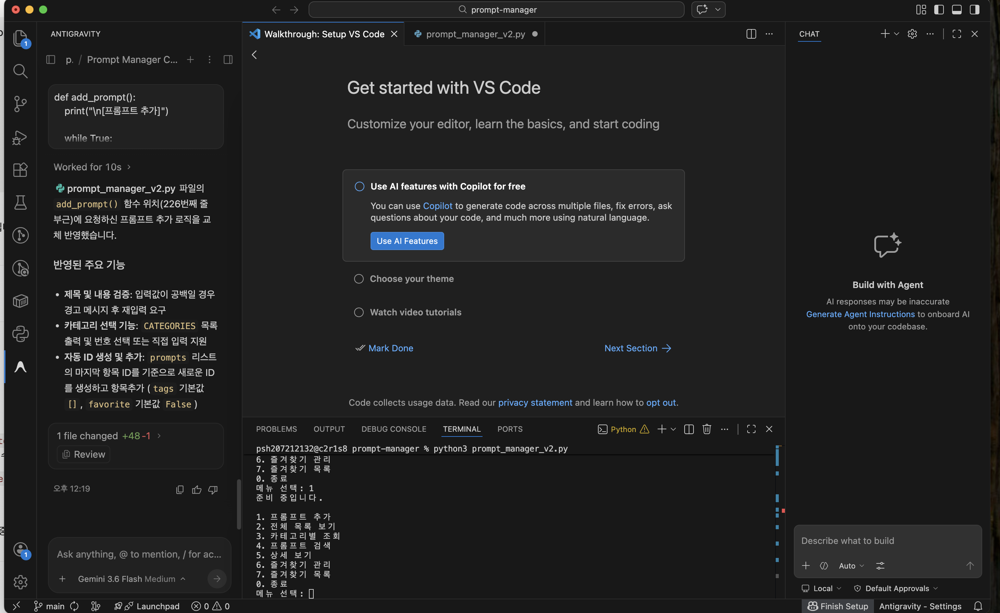

**1번 프롬프트 추가**

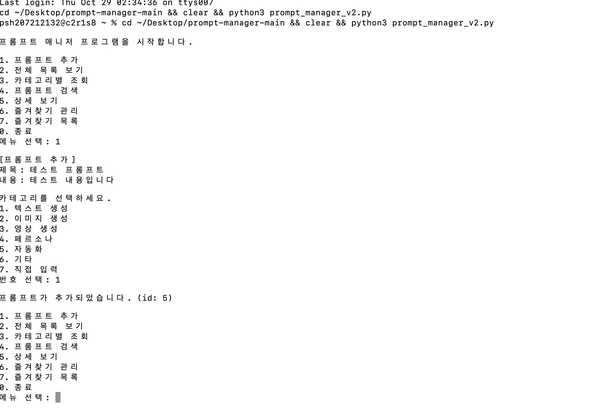

**4번 프롬프트 검색**

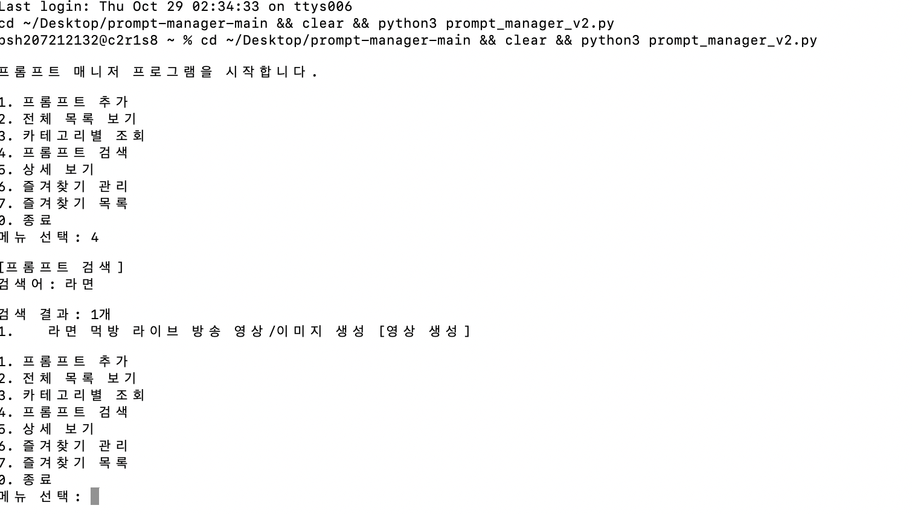

**5번 상세 보기**

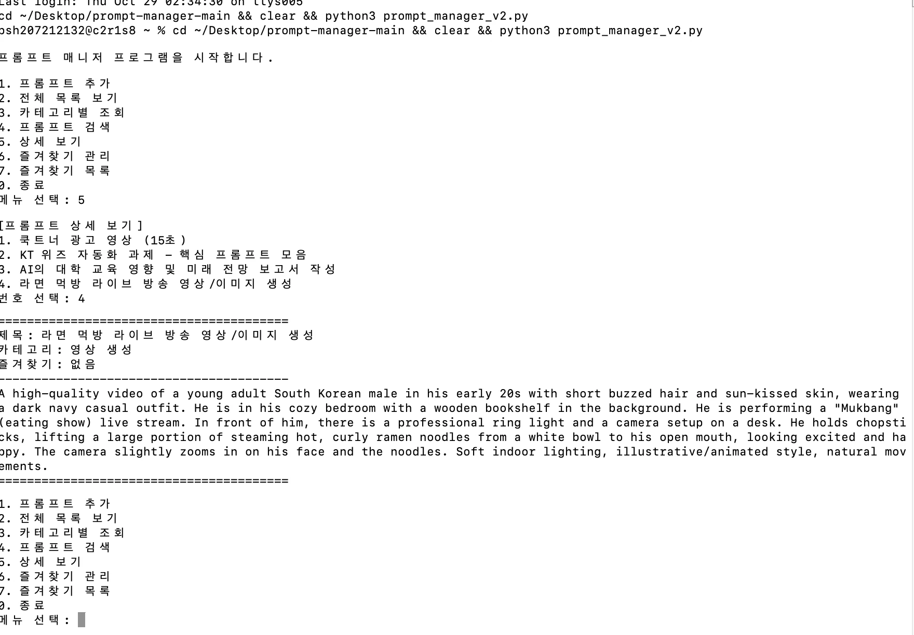

**6번 즐겨찾기 등록 및 7번 즐겨찾기 목록**

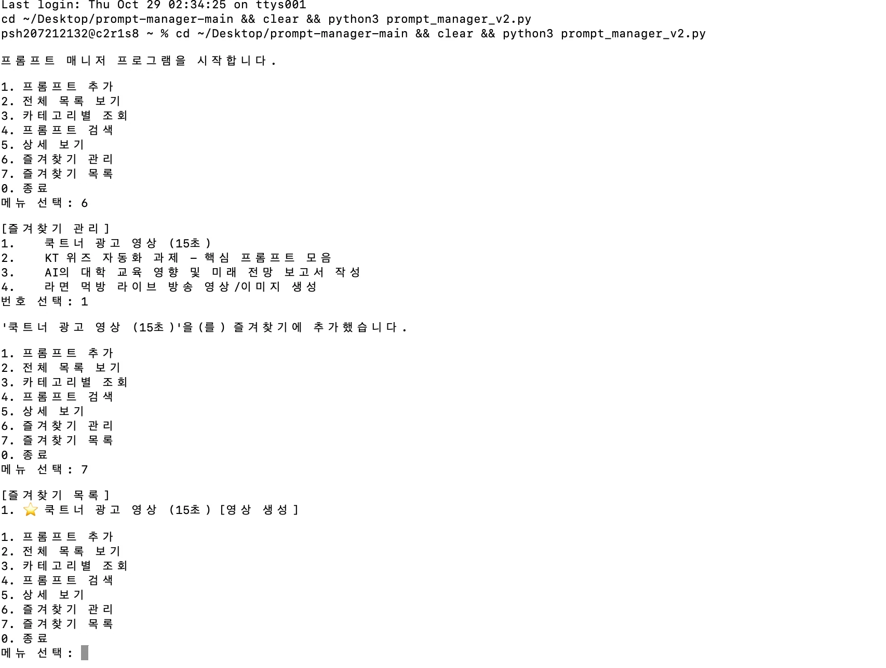

**0번 종료**

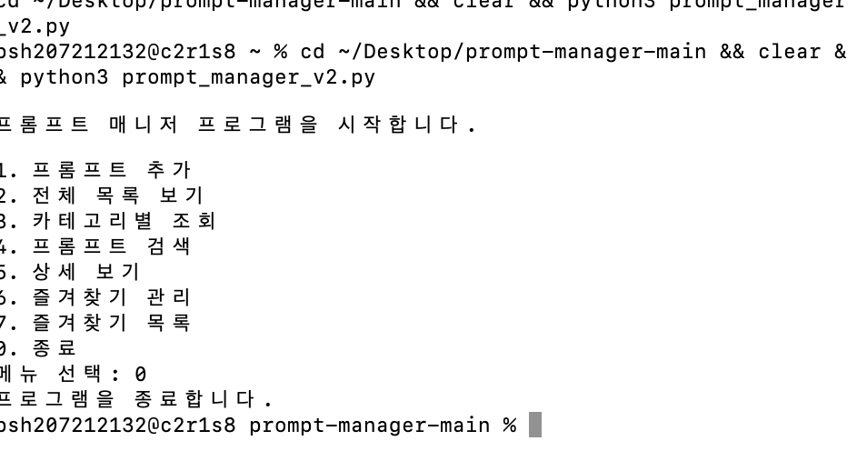

</details>

<details>
<summary>코드 구조</summary>

**카테고리 상수 및 프롬프트 데이터**

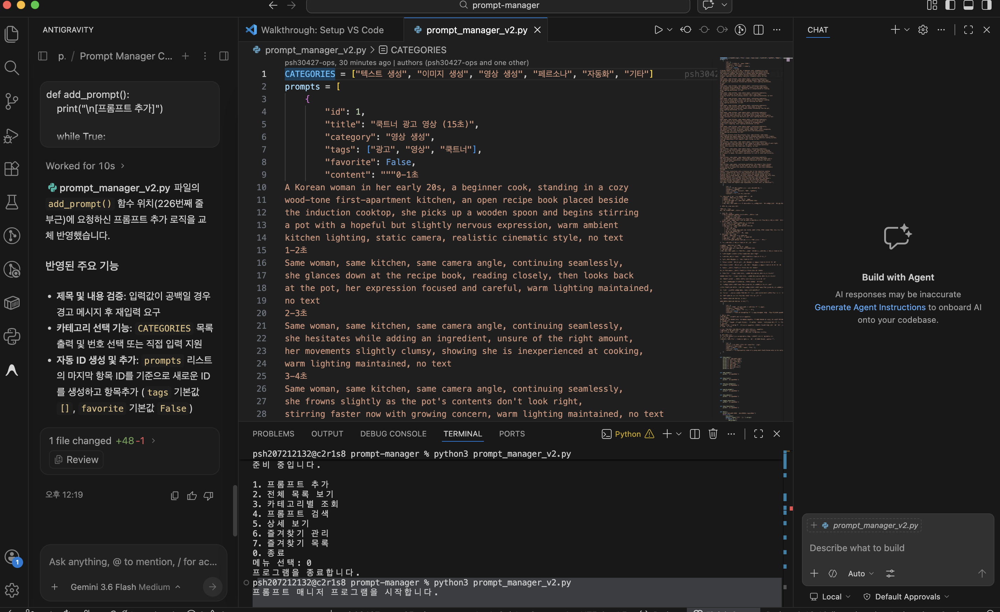

**프롬프트 추가 기능 구현**

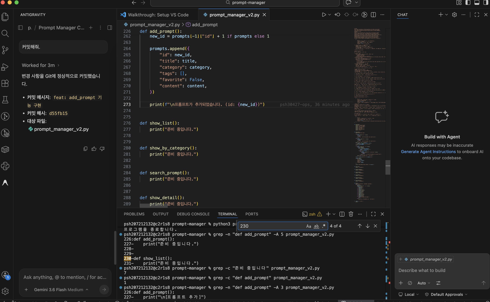

</details>

<details>
<summary>Git 브랜치 작업</summary>

**브랜치 생성, 커밋, main 병합 및 푸시**

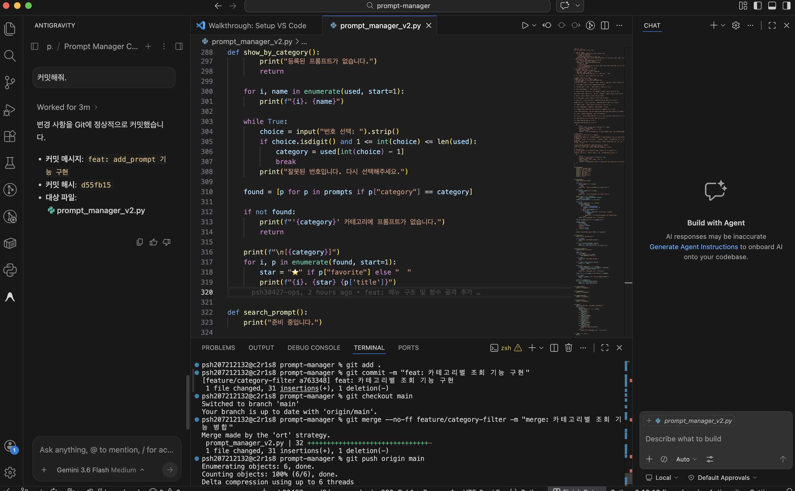

**최신 커밋 기록 및 병합 그래프 (`git log --oneline --graph`, 충돌 해결 병합 `58e0712` 포함)**

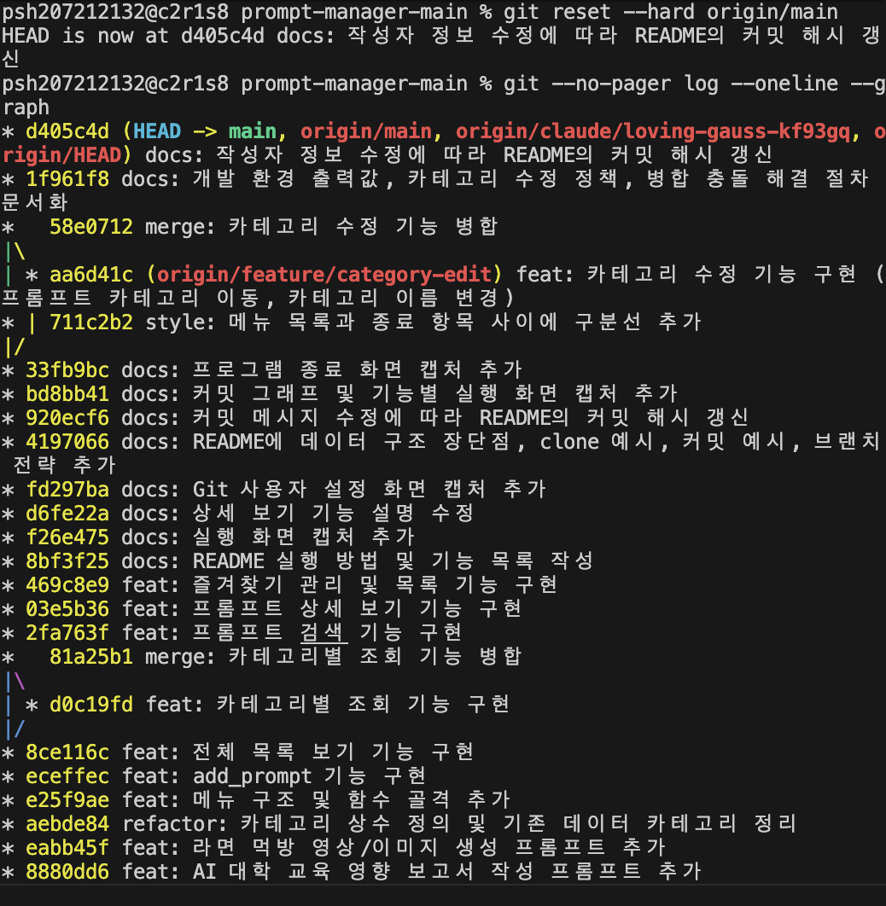

</details>

<details>
<summary>README 미리보기</summary>

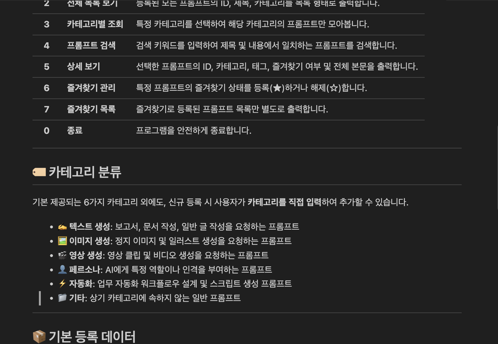

</details>